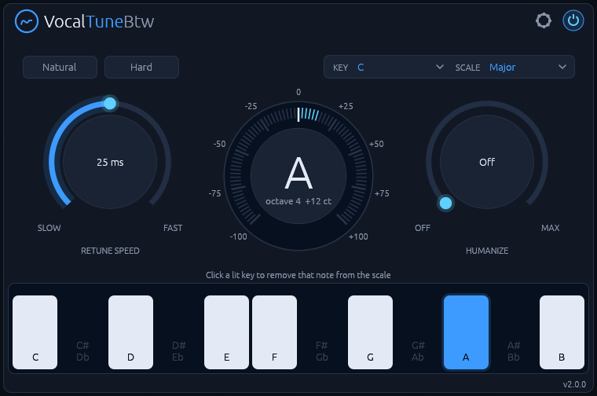

# VocalTuneBtw

**Real-time pitch correction for monophonic vocals, built natively for Linux.**
CLAP and VST3 for Linux.



VocalTuneBtw listens to a single voice, finds the nearest note in the key and scale you choose, and
glides the voice onto it. Set it fast for the hard, robotic snap. Set it slow for transparent
correction that keeps vibrato and slides intact.

It runs natively on Linux, with no network access and no telemetry.

**[Read the manual](manual.md)** for every control and how to use it.

## Features

- **Key and scale snapping:** 12 root notes and 14 scales, with per-note control on the keyboard.
- **Retune Speed from 1 to 200 ms,** with one-click Natural and Hard presets.
- **Humanize:** notes already close to the target are left alone.
- **Strength, Detune and Reference pitch:** partial correction, ±100 cents, A4 from 415 to 466 Hz.
- **Live tuning meter:** the target note, its octave and the deviation in cents.
- **Low latency:** 3.8 to 10.8 ms depending on the voice range, reported to the host.

## Install

Download the latest version from the [Releases page](https://github.com/PluginsBTW/VocalTuneBtw-release/releases),
or with these commands:

```bash
curl -LO https://github.com/PluginsBTW/VocalTuneBtw-release/releases/download/v2.0.3/VocalTuneBtw-2.0.3-linux-x86_64.tar.gz
curl -LO https://github.com/PluginsBTW/VocalTuneBtw-release/releases/download/v2.0.3/VocalTuneBtw-2.0.3-linux-x86_64.tar.gz.sha256
sha256sum -c VocalTuneBtw-2.0.3-linux-x86_64.tar.gz.sha256 && tar xzf VocalTuneBtw-2.0.3-linux-x86_64.tar.gz
cd VocalTuneBtw-2.0.3-linux-x86_64
```

Install for your user:

```bash
mkdir -p ~/.clap ~/.vst3
rm -f ~/.clap/VocalTuneBtw.clap && cp VocalTuneBtw.clap ~/.clap/
rm -rf ~/.vst3/VocalTuneBtw.vst3 && cp -r VocalTuneBtw.vst3 ~/.vst3/
```

Or for all users:

```bash
sudo mkdir -p /usr/lib/clap /usr/lib/vst3
sudo rm -f /usr/lib/clap/VocalTuneBtw.clap && sudo cp VocalTuneBtw.clap /usr/lib/clap/
sudo rm -rf /usr/lib/vst3/VocalTuneBtw.vst3 && sudo cp -r VocalTuneBtw.vst3 /usr/lib/vst3/
```

Removing the old copy first avoids overwriting a file a running host has loaded. Then rescan plugins
in your DAW.

To uninstall:

```bash
rm -rf ~/.clap/VocalTuneBtw.clap ~/.vst3/VocalTuneBtw.vst3
```

### Upgrading from 1.x

2.0 is a rewrite that sounds the same, and it keeps the plugin IDs, so projects saved with 1.x find
it. They open with default settings, though, and CLAP automation of some parameters doesn't carry
over. Set the plugin up again in old projects.

## Requirements

- Linux x86-64 with glibc 2.31 or newer (Ubuntu 20.04, Debian 11, Fedora 32 and newer)
- A CLAP or VST3 host
- X11 or XWayland, and a Vulkan driver for the editor

Releases contain the CLAP and VST3 plugins only.

## License

MIT, see [LICENSE](LICENSE). The licenses of the third-party code in the binaries are in
`THIRD-PARTY-LICENSES.txt` in each release archive.

VST is a registered trademark of Steinberg Media Technologies GmbH. CLAP is an open standard
by the free-audio project. VocalTuneBtw is an independent project, not affiliated with or endorsed
by Steinberg.
