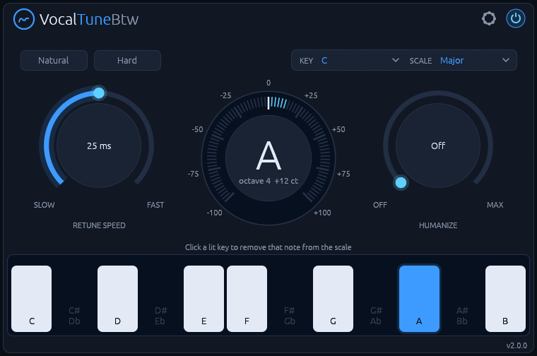
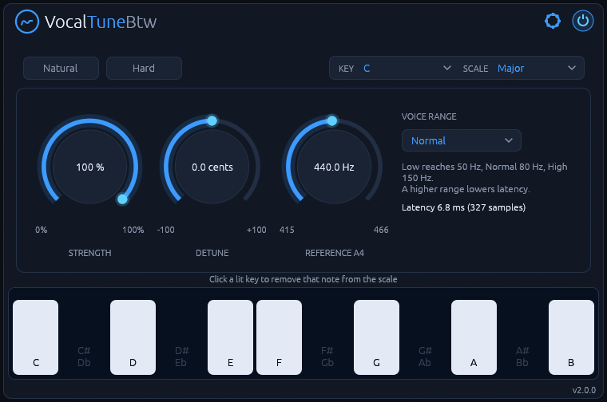

# VocalTuneBtw manual

**Real-time pitch correction for monophonic vocals, built natively for Linux.**

Version 2.0.5. To install it, see the [README](README.md).

## Getting started

1. Put VocalTuneBtw on a track with a **single voice**. It's made for monophonic vocals, not choirs
   or doubled parts.
2. Set **Key** and **Scale** to your song's.
3. Open the settings behind the gear icon and choose the **Voice Range** that fits the singer.
4. Click **Natural** for transparent correction or **Hard** for the robotic snap.

## The controls

### Main view

| Control | Range | What it does |
| --- | --- | --- |
| **Key / Scale** | 12 roots × 14 scales | The notes the voice is pulled to. |
| **Keyboard** | per note | One octave. Lit keys are in the scale; the note being corrected is blue. Click a key in the scale to switch it off (dark) or on again. |
| **Retune Speed** | 1 to 200 ms | How fast the voice moves to the target. Low values give the hard, stepped effect. |
| **Humanize** | Off to 100% | Deviations smaller than this are left uncorrected (0 to 50 cents). |
| **Natural / Hard** | presets | Set Retune Speed and Humanize in one click. The active preset lights up. |
| **Power** | On / Off | Bypass with a 10 ms crossfade. The switch is blue while the effect runs; while bypassed it turns grey and the tuning meter dims. |

### Settings

Behind the gear icon:

| Control | Range | What it does |
| --- | --- | --- |
| **Strength** | 0 to 100% | How much of the pitch error is corrected. |
| **Detune** | ±100 cents | Shifts every target note by a fixed amount. |
| **Reference A4** | 415 to 466 Hz | Concert pitch the scale is tuned to. |
| **Voice Range** | Low / Normal / High | The singer's range. Sets both the detection range and the latency. |

All controls are host parameters and can be automated. Clicking the logo opens [the plugin's page](https://rmnhofma.github.io/plugins/vocaltunebtw/).

## How to use it

### Natural or Hard

- **Natural** sets Retune Speed to 50 ms with light Humanize: the voice is guided to the note and
  keeps its vibrato and slides.
- **Hard** sets Retune Speed to 1 ms with no Humanize: the voice jumps between notes, which is the
  stepped, robotic effect.

Between these two, Retune Speed is the main control. Start from a preset and move it by ear.

### Humanize

Humanize leaves alone anything already close to the target, so held notes keep their natural
movement. Raise it if long notes sound too flat and still. Lower it if notes stay audibly off.

### Choosing the notes

The scale decides which notes the voice may land on. Choose **Chromatic** to correct to the nearest
semitone without choosing a key. **Custom** and the keyboard let you take notes away: click a lit
key to remove that note, and the voice snaps to the neighbouring notes instead. Click it again to
bring it back. This helps when a singer keeps landing on a note you don't want.

The scales are Chromatic, Major, Natural, Harmonic and Melodic Minor, Dorian, Phrygian, Lydian,
Mixolydian, Locrian, Major and Minor Pentatonic, Blues and Custom.

### Strength, Detune and Reference

**Strength** below 100% corrects only part of the error, for a subtle touch. **Detune** shifts every
target by a fixed amount, up to ±100 cents. **Reference A4** tunes the whole scale, for material
that isn't at 440 Hz.

### Voice Range and latency

The pitch shifter needs about half a cycle of the lowest note it has to handle, so a higher Voice
Range means lower latency. Pick the **highest range that still covers the singer's lowest note**.
Values at 48 kHz:

| Voice Range | Lowest note | Latency |
| --- | --- | --- |
| Low | 50 Hz | 10.8 ms |
| Normal | 80 Hz | 6.8 ms |
| High | 150 Hz | 3.8 ms |

The current value is shown on the settings page, and the plugin reports it to the host for automatic
delay compensation.

## Good to know

- **The start of a note:** detection needs some audio before it recognises a new note, so the start
  of a note is corrected roughly 25 to 30 ms late. This doesn't delay the audio itself.
- **Stereo:** the channels are shifted together, so the image stays intact.
- **Audio:** mono or stereo, at whatever sample rate the host uses.
- **Hosts:** tested in Bitwig Studio. Other CLAP or VST3 hosts should work but haven't been tried.
- **Display:** X11, or XWayland on a Wayland desktop, with a Vulkan driver.

## Troubleshooting

- **The plugin doesn't show up:** check that the bundle is in `~/.clap`, `~/.vst3`,
  `/usr/lib/clap` or `/usr/lib/vst3`, then rescan plugins in your DAW.
- **The editor window stays black or doesn't open:** check that a Vulkan driver is installed.
  The `vulkaninfo` tool from `vulkan-tools` should list your GPU. Bitwig Studio writes plugin
  errors to `~/.BitwigStudio/log/engine.log`.
